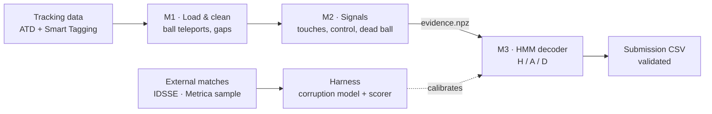

<div align="center">

# ⚽ RONDO

**Robust Ownership from Noisy Data, Offline**

Frame-by-frame ball possession for **FC Barcelona vs Athletic Club**, built for
[More Than A Hack 2027](https://github.com/metrica-sports/more-than-a-hack-2027).

[](https://github.com/krishnavallabha/RONDO/actions/workflows/ci.yml)


*Every label comes from code. No hand annotations, no tuning on this match's ground truth.*

</div>

---

## What it does

For each of the **199,319** frames of the tactical video, RONDO writes one label:

| Label | Meaning |
|:-:|---|
| `H` | Home (FC Barcelona) in possession, ball alive |
| `A` | Away (Athletic Club) in possession, ball alive |
| `D` | Dead ball |
| `X` | No answer (only written where nothing is scored: before kickoff, halftime, after the whistle) |

The ranking metric is **spellF1**. It scores whole possessions, matched by temporal overlap, not
individual frames. That means the number and length of possessions matters more than per-frame
accuracy, so RONDO decodes the match with a sticky model instead of labelling frames one by one.

## How it works



1. **Signals (M0–M2):** load the tracking data, clean the ball track, and turn it into per-frame
   evidence: touches, sustained control per team, duel zones, dead-ball probability.
2. **Decoder (M3):** a three-state hidden Markov model over `{H, A, D}`, solved offline with
   Viterbi, one half at a time. Switching costs make it sticky, so it doesn't flicker on noise.
   Direct `H↔A` switches (interceptions) are allowed but cost more than going through `D`.
3. **Harness:** every parameter is chosen on **external** matches with known labels, made as
   noisy as this match's data. A change is kept only if it beats bootstrap noise (~0.04 spellF1).

## Quick start

```bash
git clone https://github.com/krishnavallabha/RONDO.git
cd RONDO
pip install -r requirements.txt

# Run the full pipeline on synthetic evidence (no match data needed)
python -m rondo.run --dummy --out out/dummy.csv

# Check it with the official validator
python more-than-a-hack-2027/evaluation/validate_submission.py out/dummy.csv

# Tests
python -m unittest discover -s tests -v
```

With real evidence (needs the match data, see below):

```bash
# M1 + M2: tracking data -> out/evidence.npz (about 5 minutes)
python -m rondo.signals.export --out out/evidence.npz

# M3: evidence -> validated submission CSV
python -m rondo.run --evidence out/evidence.npz --out out/RONDO.csv
```

Optional one-off M0 inspection of the ATD channels (`ball_state`, `ball_owning_team`) needs
`kloppy`, which the pipeline itself does not:

```bash
pip install -r requirements-m0.txt
python -m rondo.signals.m0_inspect
```

The match data is gated and is **not** in this repo. Unpack it into
`more-than-a-hack-2027/data/` or set `MTAH_DATA_DIR` (see
[DATA.md](more-than-a-hack-2027/DATA.md)).

## Repository layout

```
RONDO/
├── rondo/
│   ├── contract.py     M2 → M3 evidence contract (keys, shapes, missing values)
│   ├── decoder.py      M3 HMM + Viterbi, graded-range and X policy
│   ├── submission.py   CSV writer, re-checked with the official validator
│   ├── dummy.py        synthetic evidence for running end to end without data
│   ├── run.py          evidence → decoder → CSV
│   └── signals/        Signals (A): M0 inspect, M1 ingest + ball cleaning, M2 evidence, export
├── tests/              unit + end-to-end tests (run in CI)
├── more-than-a-hack-2027/   official challenge repo: scorer, rules, starter code
└── .github/workflows/  CI: tests, dummy run, official validator
```

## M2 → M3 interface contract

Signals saves one array per key with `np.savez_compressed`, indexed by **tactical video frame**
(length 199,319). Source of truth: [`rondo/contract.py`](rondo/contract.py).

| Key | Type | Values | Missing |
|---|---|---|---|
| `ball_xy` | float (n, 2) | metres on 105×68 pitch | `NaN, NaN` |
| `ball_missing` | bool | True where ball is unknown | `True` |
| `touch_H` / `touch_A` | bool | True on the frame of a touch | `False` |
| `control_H` / `control_A` | bool | team has sustained control (k frames) | `False` |
| `duel_zone` | bool | both teams within control radius | `False` |
| `dead_ball` | float [0–1] | soft probability of dead ball | `0.5` |
| **`restart_team`** | **float** | 0 = H, 1 = A | **`NaN`** |
| `smart_tag_dead` | float [0–1] | Smart Tagging set-piece/goal prior | `0.5` |
| **`smart_tag_team`** | **float** | Smart Tagging team tag (soft only) | **`NaN`** |

> [!IMPORTANT]
> **`restart_team` and `smart_tag_team` are floats, and unknown is `NaN`, not `-1`.**
>
> - Valid values are exactly `0.0` (H), `1.0` (A) or `NaN` (unknown). `contract.check` rejects anything else.
> - Signals' internal arrays use `-1` for unknown, but `python -m rondo.signals.export` converts them
>   before saving, so the decoder never sees `-1`.
> - Decoder code must test with `np.isnan(x)` or `x == 0` / `x == 1`. **Do not** write `x == -1`,
>   `x < 0` or `x >= 0`: `NaN` compares false to everything, so those checks silently match nothing.
> - Mask before arithmetic, for example `known = ~np.isnan(ev["restart_team"])`, or `NaN` will
>   spread through any sum, mean or log built on these keys.
>
> Every other key has no `NaN`: booleans use `False`, probabilities use `0.5`, and only `ball_xy`
> is `NaN` where the ball is missing (check `ball_missing` first).

## Team

| | Role | Owns |
|:-:|---|---|
| **A** | Signals | M0 · M1 · M2 · M4 broadcast sync · M5 ball detector |
| **B** | Decoder | M3 · restart logic · boundary snapping · expected-F1 decoding · M6 event spotting |
| **C** | Harness | validation harness · corruption model · M7 learned emissions · technical doc · reproducibility |

## Progress

- [x] **Nov 12** Decoder skeleton on dummy evidence, graded-range + X handling, CSV writer, validator in CI
- [x] **Nov 12** Signals M0 (no Metrica possession channel in the export), M1 ingest + ball cleaning, M2 evidence; real `evidence.npz` passes `contract.check` and decodes to a CSV the official validator accepts
- [ ] **Nov 12** Lock the M2 → M3 contract with the whole team
- [ ] **Nov 13** Full HMM with minimum durations + restart logic; **first valid upload**
- [ ] **Nov 14** Boundary snapping + expected-F1 decoding; core pipeline frozen
- [ ] **Nov 15** Add-ons (M4–M7), each kept only if it beats bootstrap noise
- [ ] **Nov 16** Technical document, clean-clone reproduction, final upload

## Rules we follow

- No hand labels on this match. Every label comes from code.
- No training, fitting or tuning on this match's ground truth or video.
- The public 5-minute window is a correctness check only. No setting is chosen by its score.
- No match data uploaded to any hosted AI service, and none committed to this repo.
- The submitted CSV regenerates byte for byte: pinned versions, fixed seeds, `\n` line endings.

## License & credits

Challenge data, scorer and starter code © [Metrica Sports](https://github.com/metrica-sports/more-than-a-hack-2027),
used under their terms (see [`more-than-a-hack-2027/LICENSE`](more-than-a-hack-2027/LICENSE)).
